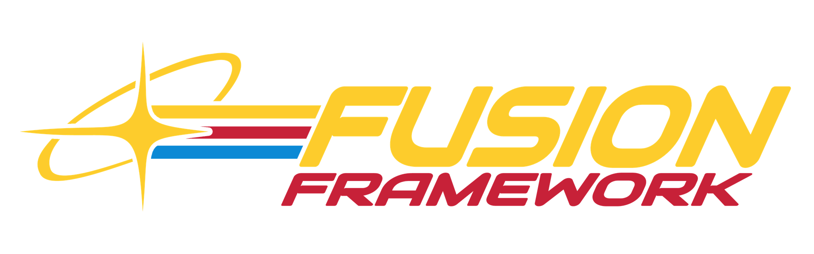

# Fusion Framework



Fusion Framework, shared F4SE tooling for all Fusion family mods. A static set of sources compiled
into each consumer's own plugin DLL (like Fusion UI), so every mod ships and releases on its own.

| Header | What |
|---|---|
| `fusionframework/FormLookup.h` | `forms::LoadedFile/LookupFormID/LookupForm<T>` against the compiled load order |
| `fusionframework/Log.h`, `fusionframework/Paths.h` | `log::Init(plugin)`, `paths::GameRoot()`, `paths::DataDir(plugin)` |
| `fusionframework/Config.h` | every plugin's TOML config (toml11): `config::Document` typed get/set that keeps comments, `config::Store` cached reads, atomic writes, shipped defaults |
| `fusionframework/PluginToml.h` | `config::LoadPluginToml(plugin)`: `Data/F4SE/Plugins/<plugin>.toml`, logged, defaults when missing |
| `fusionframework/Hooks.h` | `hooks::Install(hooks, feature)`: all-or-nothing MinHook install (REL::ID or VariantID) with rollback |
| `fusionframework/ActorUpdate.h` | `actors::OnUpdate` (per actor, per frame: RestoreHealth inside UpdateMagic), `actors::OnRestoreHealth`, `actors::Install()` |
| `fusionframework/Task.h` | `task::Every(interval, gate, tick)`: coalesced game-thread ticker |
| `fusionframework/SourceTemplates.h` | `forms::TemplateSource(actor, category)`: the NPC that owns a template category |
| `fusionframework/TalesMapContract.h` | Tales ↔ Full Screen Map message contract (`tales_map`) |
| `fusionframework/Translations.h` | loads `Data/F4SE/Plugins/<table>_<lang>.txt` into the Scaleform translator |
| `fusionframework/PluginCatalogRules.h`, `fusionframework/PluginCatalog.h` | per-plugin JSON catalogs, `F4SE/Plugins/<owner>/<feature>/<plugin>.json` |
| `fusionframework/PapyrusCompat.h` | safe `PackVariable`/`UnpackVariable` specializations; include it in every TU (pch) |
| `fusion-framework-minhook` | MinHook static library target |

## Use

```lua
includes("../fusion-framework-fo4/xmake.lua")

target("MyPlugin")
    add_rules("commonlibf4.plugin", { ... })
    add_packages("spdlog", "nlohmann_json")
    fusionframework_use()            -- headers, sources, MinHook

target("my_tool")
    fusionframework_use_config()     -- headers + config Document/Store, needs spdlog, no engine code

target("my_tests")
    fusionframework_use_pure()       -- headers + config Document only, no engine or Windows code
```

Config files are TOML. Keep every comment directly above the key or table header it describes:
saves keep those comments but drop blank lines and free-floating comments.

The consumer provides CommonLibF4, spdlog and nlohmann_json, and its pch must include
`fusionframework/PapyrusCompat.h` (after `RE/Fallout.h`): the framework compiles those Papyrus
specializations into the DLL, so every translation unit has to see them.

## More

- [AI contributions](AI_CONTRIBUTIONS.md)
